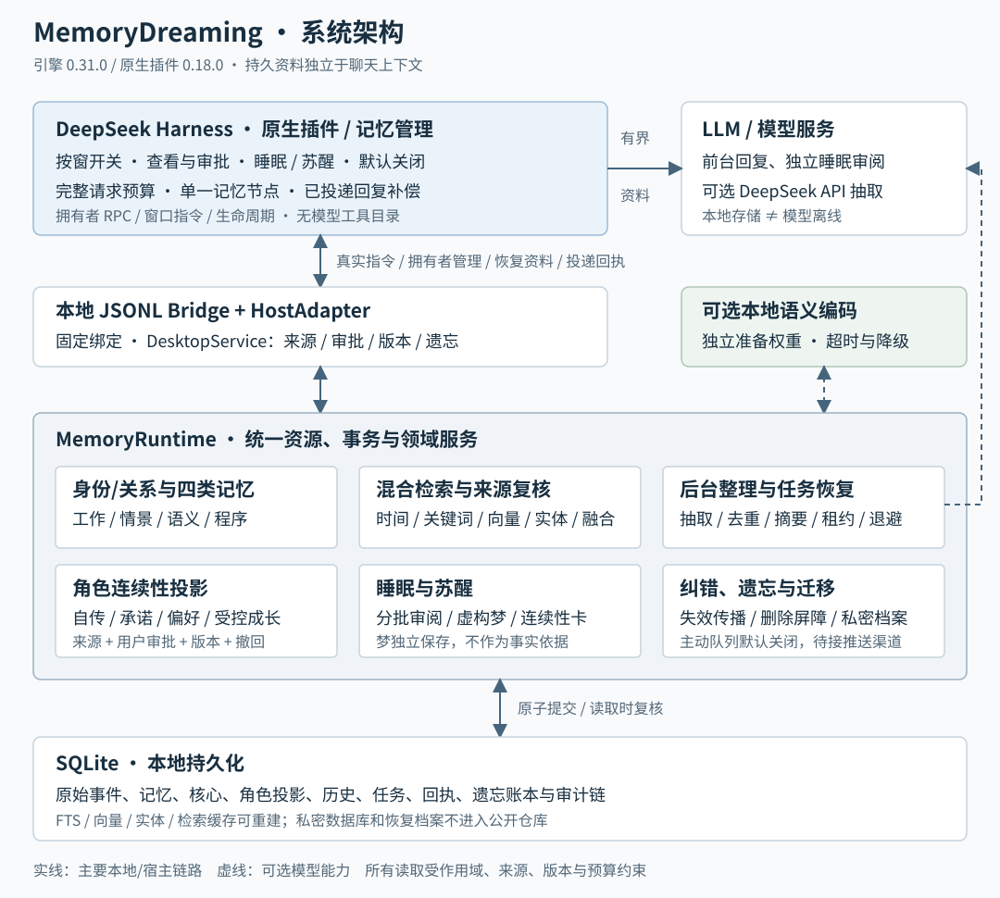

# MemoryDreaming

面向长期陪伴角色的本地记忆引擎与 DeepSeek Harness 原生插件，让角色跨窗口恢复**身份、关系、共同经历和未完事项**。

[English](README.en.md) · [快速上手](docs/quickstart.md) · [架构](docs/architecture-overview.md) · [文档导航](docs/README.md) · [路线图](ROADMAP.md) · [更新记录](CHANGELOG.md)

[](https://github.com/Evergardenxxx/dsh-MemoryDreaming/actions/workflows/ci.yml)

代码与问题反馈：[GitHub仓库](https://github.com/Evergardenxxx/dsh-MemoryDreaming) · [Issues](https://github.com/Evergardenxxx/dsh-MemoryDreaming/issues)。

**当前为可运行试用版：引擎 v0.31.0 / 原生插件 v0.18.0 / 数据库 schema 27。** 引擎、原生接入与首版桌面管理已实现；真实 DeepSeek 抽取质量、长期角色稳定性和当前登录模型的完整桌面流程仍待验收。详见[能力与证据](docs/open-problems.md)。

## 为什么做这个项目

聊天上下文会压缩、耗尽，窗口也会关闭。MemoryDreaming 将长期资料保存在模型上下文之外；每轮只恢复与当前交流有关的一小部分，而不是把全部聊天重新塞进提示词。

- **核心与四类记忆**：受控身份/关系，以及工作、情景、语义、程序记忆。
- **可核对的来源**：保留原始事件、来源版本、认识论状态和虚构标签，支持纠错与遗忘传播。
- **按窗口参与**：默认关闭，由用户显式开启；启用窗口在同一可信身份范围内共享长期资料。
- **睡眠与苏醒**：分批审阅本窗已保存的对话，保存独立虚构梦和有限、可逆的召回权重调整。
- **角色连续性**：自传、承诺、相处偏好、受控表达成长、苏醒自检和私密迁移档案。
- **桌面管理**：Harness侧栏查看记忆和来源、审批候选、确认纠错/遗忘、初始化空角色，查看窗口与睡眠状态。
- **上下文有界**：原生插件不注册 MCP 工具，默认记忆预算为1200个估算token，完整请求另做预算检查。

## 架构



原生 Cordis 插件负责真实用户指令、窗口开关和模型生命周期；本地 Python JSONL 桥接负责固定身份绑定；引擎统一管理来源、检索、角色投影、后台任务和 SQLite。普通回合、睡眠流程及可编辑 Mermaid 源图见[架构总览](docs/architecture-overview.md)，模块职责见[系统架构](docs/system-architecture.md)。

## 先运行一个示例

在下载或克隆的仓库根目录执行，只需 Python 3.10 以上：

```bash
python -X utf8 examples/host_lifecycle.py
```

示例使用临时数据库，建立身份与关系、记录偏好、关闭运行时，再从新窗口恢复并回溯原话；不调用外部模型。它验证引擎链路，不代表 LLM 的回答质量。

## 安装到 DeepSeek Harness

在源码或离线包根目录运行，目标须为仓库外的新目录：

```powershell
python scripts/install.py --destination "D:\Apps\MemoryDreaming" --user u1 --character c1 --relationship r1
```

安装器创建独立 Python 环境、插件、数据目录和配置。随后在 Harness 原生插件管理器中选择生成的 `plugin` 目录并重载应用。离线包自带 wheel；Python、可选语义权重和宿主应用需另行准备。

重载后点击侧栏“记忆管理”。首次设置角色可在“绑定与诊断”中填写并确认，也可使用[初始化示例](docs/quickstart.md#首次设置角色)。新库不会自动编造身份；修改已有角色应走可信宿主审批。

管理页面始终使用插件配置的固定角色绑定，没有运行中窗口也能浏览。窗口选择器只选择对话；开启、关闭、睡眠和苏醒按钮会提交对应真实用户指令，“已接收”不等于处理完成。详细用法与限制见[桌面管理指南](docs/desktop-management.md)。

在目标窗口中分别发送整条消息：

```text
记忆开启
记忆偏好 {"key":"安慰方式","value":"先倾听，再询问是否需要建议"}
记忆承诺 {"text":"下次继续灯塔故事","event_trigger":"故事继续"}
记忆自检
```

准备换窗口时发送 `记忆睡眠`，等待整理完成，再到新窗口发送 `记忆苏醒`。用 `记忆关闭` 停止当前窗口参与。完整指令见[长期角色指南](docs/long-term-role.md)与[睡眠/苏醒指南](docs/window-sleep-wake.md)。

## 当前能力与边界

| 能力 | 当前状态 |
|---|---|
| 持久存储、核心与四类记忆、跨窗口恢复 | 已实现；来源、作用域、版本和预算受工程回归覆盖 |
| 原生窗口开关、睡眠审阅、虚构梦、苏醒 | 已实现；安装版运行时已使用确定性模型适配器验收 |
| 自传、承诺、偏好、成长 | 已实现SDK与显式JSON指令；推测不会自动获得审批权 |
| 桌面记忆与候选管理 | 原生页面支持四类角色资料表单、状态操作和历史查看，以及记忆/候选管理；核心字段编辑与图形档案迁移待开发 |
| 纠错、遗忘与迁移 | 本地传播及私密新设备恢复已实现；已发送上下文和外部旧备份不能自动撤回 |
| 自动抽取 | 默认规则覆盖有限；可选DeepSeek API抽取器已接入，真实质量尚待验收 |
| 场景偏好 | SDK支持显式场景；普通原生回合目前读取default，自动场景选择未接入 |
| 主动提醒 | 默认关闭的授权/频率/安静时段/租约队列已实现，实际定时推送渠道未接入 |
| 精确计量与质量 | 默认estimated；当前V4.1线上usage、独立人工质量和长期陪伴验收尚未完成 |

v0.31本地通过**790项工程回归、27条安装版运行时隔离路径、21条浏览器操作路径**。浏览器验收连接真实Python桥接与临时SQLite，宿主指令接纳及模型输出使用确定性适配器；这些结果不等于当前用户Electron窗口、登录模型或长期真实质量已验收。证据范围与复跑方法见[桌面管理](docs/desktop-management.md)、[安装版验收](docs/installed-harness-acceptance.md)和[质量验收](docs/quality-acceptance.md)。

## 数据、模型与安装包体积

数据库存放在本地，原生默认路径为 `.memorydreaming/deepseek-harness.db`；隔离安装器使用安装目录下的 `data/memory.db`。睡眠审阅会将分片发送到 Harness 当前模型；启用可选DeepSeek抽取后，用户事件会发往配置的API。**本地存储不意味着所选模型离线。**

离线包只包含代码、文档、测试和插件包，不包含大模型、Python/Node运行时或语义权重，因此体积较小。私密连续性档案包含原话和HMAC恢复密钥，应按数据库备份保护，不上传公开仓库。配置清单见[.env.example](.env.example)，它不会被自动加载。

## 开发与参与

```bash
python -m pip install --editable .
python -m unittest discover -s tests -q

git diff --check
```

原生插件开发/回归还需Node.js；CI当前使用Node 22。阅读[开发导读](docs/development-guide.md)、[贡献指南](CONTRIBUTING.md)与[路线图](ROADMAP.md)。问题复现请使用合成对话和临时库；漏洞报告方式见[SECURITY.md](SECURITY.md)。

采用[MIT许可证](LICENSE)。开源发布准备见[GitHub发布清单](docs/github-publication.md)，参考项目与借鉴边界见[参考来源](docs/references.md)。
