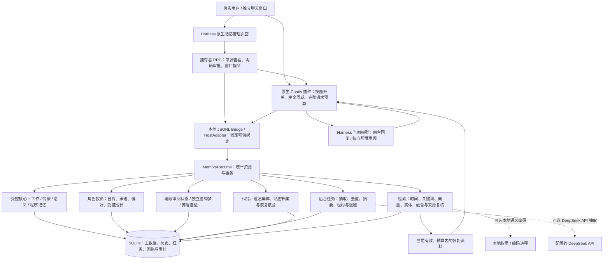
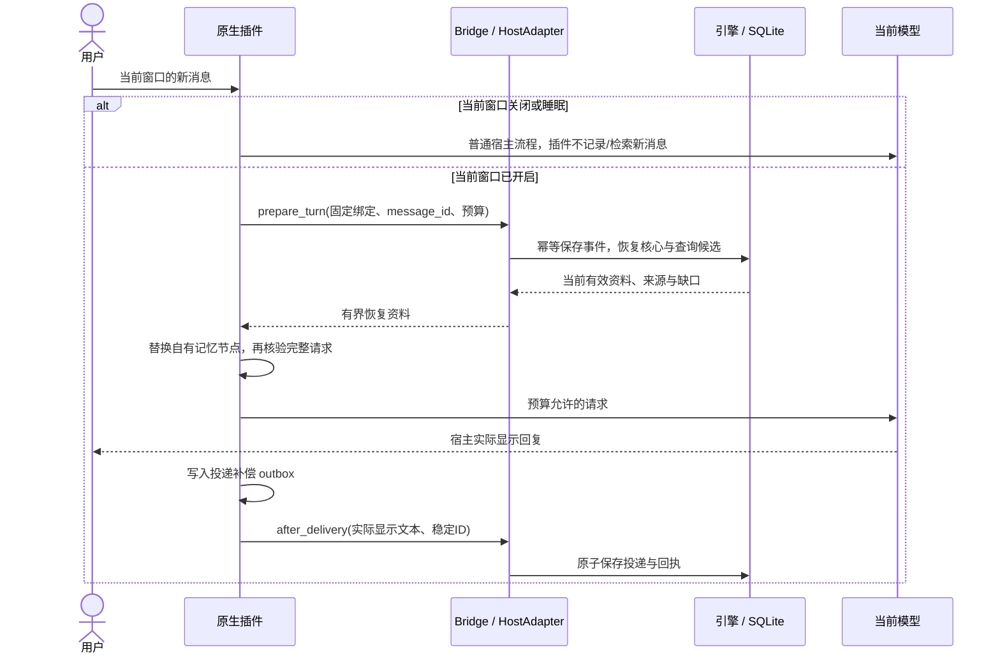
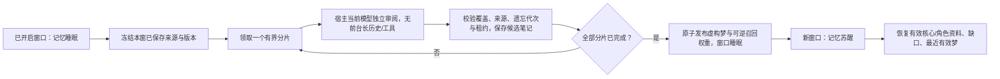

# 架构总览

本文对应引擎0.30.0 / 原生插件0.17.0 / schema27的当前实现。早期设计目标保留在[架构v0.2](architecture-v0.2.md)中，尚待验收的能力见[路线图](../ROADMAP.md)。

SVG可直接用于GitHub首页、演示或导出；[Mermaid源图](diagrams/architecture.mmd)用于修改结构。以下Mermaid图在GitHub中可直接渲染，SVG是同一架构的简化展示。

## 系统边界

原生插件不注册MCP工具目录。SDK保留查询/审批接口，仓库另有早期只读兼容模块；它们不参与当前Harness原生链路。user/character/relationship/activity/domain决定长期资料边界，conversation_id决定窗口来源与开关；换窗口不会创建一套新的角色记忆。

管理页面使用宿主共享客户端与原生RPC，不新增监听端口。`DesktopController`核对真实拥有者身份，`DesktopService`复用同一引擎的来源和版本检查；窗口按钮通过宿主的真实用户指令通道执行。页面数据不进入模型上下文，也不会因打开页面而开启任何对话窗口。使用和剩余界面工作见[桌面管理](desktop-management.md)。

## 普通回合

后台抽取/编码不占用写事务；最终发布重新检查来源、内容代次、遗忘屏障和租约。模型只返回候选，核心/角色变化仍要求可信宿主审批；完整JSON用户命令是独立核对原话后的显式快捷路径。

## 睡眠与新窗口苏醒

梦是独立`generated_fiction`派生物，不能作为事实或人格证据。睡眠笔记也不自动变成已批准事实。来源撤销会传播到梦、角色投影、历史展示与恢复卡。主动提醒队列和睡眠没有自动外发权限。

## 进一步阅读

模块和扩展点见[系统架构](system-architecture.md)，形成/路由/时间/排序见[算法规格](algorithms-v0.2.md)，对外绑定/引用/预算见[宿主指南](host-adapter.md)。[睡眠说明](window-sleep-wake.md)、[角色连续性](long-term-role.md)和[来源组](evidence-groups.md)解释各自的行为及验收边界。
