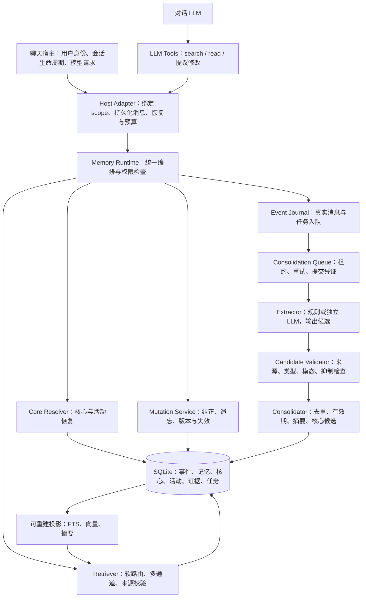
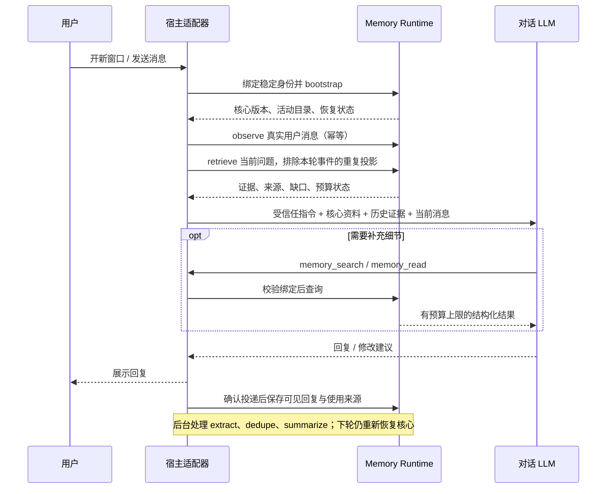

# MemoryDreaming 架构 v0.2

日期：2026-10-26。代码基线：v0.5.0 / `48cf876`，SQLite schema v5。本文是后续开发的设计基线，**不表示所有模块已实现**。算法见 [算法规格](algorithms-v0.2.md)，调用契约见 [LLM 接口协议](llm-interface-v1.md)。v0.1 保留为早期提案与开源参考记录。

v0.6 进展：schema v6 已实现持久事实抑制、来源片段、scope mutation epoch、核心字段来源及领域/关系版本隔离，见 [实现说明](fact-suppression.md)。以下状态表已同步；完整擦除与类型化证据组仍未实现。

v0.7 进展：HostAdapter、受控引用、逐轮记忆预算和 MCP 两个只读工具已实现，schema v7 新增实际投递记录，见 [接入指南](host-adapter.md)。具体聊天产品的生命周期 hook 和供应商工具往返仍待完成。

v0.8 进展：schema v8 新增持久核心候选。Python 宿主显式启用字段白名单后，LLM 可提出候选；宿主审批重新校验来源/版本并原子追加核心和回执，见 [核心候选](core-proposals.md)。自动人格归纳、检查点建议及通用修改工具仍待完成。

## 1. 目标与不变量

让同一角色在窗口关闭、上下文压缩、进程重启和更换模型后，恢复身份、关系、共同经历及未完事项。连续性来自持久状态及宿主恢复过程，模型每次只接收当前需要的一小部分记忆。

1. `conversation_id` 仅表示对话来源，不参与角色记忆的永久分区。
2. 核心按稳定身份键直接读取，不能依赖向量相似度决定“我是谁”。
3. 工作、情景、语义、程序是功能分类；一个事件可支持多类记忆，四类可共用 SQLite。
4. 所有读写都绑定可信作用域；知道某条记录的 ID 不代表有权读取它。
5. 原始事件、候选、已接受断言与核心投影分别保存。模型回答不是用户经历的证据。
6. 来源、发生时间、有效时间、记录时间分别表达；访问热度不提高真实性。
7. 48 小时改变默认展开粒度；较旧的原话、日期与实体仍能精确回查。
8. 纠正和遗忘必须使来源链、摘要、向量、核心投影及在途任务一致变化。
9. 所有模型输出先当候选校验；工具调用由宿主检查参数、作用域和实际用户意图。
10. 恢复失败、证据不足、预算截断和功能不支持必须可观察，不能伪造恢复成功。

例如用户明确希望以父女角色相处：关系核心保存这项设定、称呼偏好及来源；历次互动形成共同经历。称呼不因换窗口丢失，也不会把模型编出的经历当成双方真实发生过的事件。

## 2. 模块与依赖



LLM 服务是可替换的计算提供者。对话模型、记忆抽取模型和嵌入模型可以分别选择；模型供应商的消息格式不进入存储模型。原始事件与已经接受的记忆构成持久底座，索引是派生物。

| 模块 | 输入与输出 | 当前状态 |
|---|---|---|
| Runtime / Repositories | Python 数据类型与 SQLite 事务 | 已实现 |
| Core Resolver | bootstrap、核心版本、活动目录 | 已实现核心键、字段来源和宿主记忆预算；完整供应商请求预算待接入 |
| Retriever | Query → 证据、摘要、缺口、轨迹 | 已实现规则路由与混合检索 |
| Consolidation Queue | extract → dedupe → summarize | 已实现租约与原子提交 |
| Extractor | EventRecord → MemoryDraft[] | 规则版已实现，模型抽取待接入 |
| Mutation Service | 撤回、替代、来源变化、删除 | 已实现部分纠正与事实抑制；正文擦除待实现 |
| Host / LLM Adapter | 会话钩子、JSON 工具、参数与权限校验 | 已实现 Python 生命周期、可选核心建议与宿主审批、MCP 只读服务；产品 hook 与通用修改待接入 |
| Evidence / Tombstone | 类型化来源、依赖组、持久抑制、版本栅栏 | 抑制与 scope epoch 已实现；类型化 AND/OR 组待实现 |
| TokenCounter / Embedding Provider | 目标分词器与真实语义向量 | 可注入 TokenCounter；默认估计与哈希向量，真实模型待接入 |

## 3. 核心与四类记忆

核心是长期被接受的身份和关系信息的版本投影。它承担入口和恢复功能，检索接口仍由运行时提供；核心文本本身不会注册工具或取得操作权限。

| 记忆 | 内容与形成格式 | 形成依据 | 读取方式 |
|---|---|---|---|
| 核心 core | identity / relationship；字段值、字段来源、版本、变更原因 | 明确角色设定，或已审核的长期归纳 | 每次模型请求前直接恢复最小核心；完整版本按需展开 |
| 工作 working | goal、open_loops、active_entities、checkpoint_note；绑定 activity | 已确认目标、未完承诺、当前进度 | 活动主键与版本优先，检索补充 |
| 情景 episodic | what_happened、participants、context、outcome、事件区间 | 可回源的对话事件或用户自述；说明说话者与模态 | 日期、参与者、关键词、语义及原话展开 |
| 语义 semantic | subject、predicate、obj、scope_note、有效期 | 明确陈述或有来源支持的归纳 | 实体与关系、当前/历史有效性、混合检索 |
| 程序 procedural | trigger、preconditions、steps、exceptions、expected_outcome、supporting_examples | 用户明确建立的习惯，或经验证的步骤 | 触发条件与前置条件匹配；只提供建议步骤 |

`importance` 表示保留价值；`retrieval_strength` 表示容易被想起；`epistemic_status` 表示依据类别；`modality` 区分发生、意愿、假设、引用、虚构。四者独立保存。程序记忆仍是资料，不能绕过宿主授权执行其中的步骤。

当前 `body` 使用上表字段，语义客体名为 `obj`。后续外部契约继续沿用这一拼写，避免 JSON 字段与 Python 类型不一致。声明式格式见 [抽取契约](contracts/extraction-response.schema.json)。

## 4. 作用域与稳定身份

目标外部服务的绑定为：

```text
SessionBinding（宿主创建，不由 LLM 填写）
  principal_id / user_id
  character_id
  relationship_id（显式默认关系也使用非空 ID）
  domain
  conversation_id
  selected_activity_id? / allowed_activity_ids
  authorization_context
```

目标核心键：身份 `(user_id, character_id, domain)`；关系 `(user_id, character_id, relationship_id, domain)`；活动按完整作用域与活动 ID 定位。身份核心可在同一领域的多个关系间共享，关系称呼与约定单独版本化。

当前本地记忆/活动查询中 `Scope.relationship_id=None`、`activity_id=None` 有宽范围查询语义。v0.6 核心仓储已按关系/领域独立维护版本，核心读取中的 None 关系仅表示默认关系。**不能把宽范围查询语义直接透传给外部 LLM。** 新适配器必须采用显式默认关系、受控活动目录及逐项复核。旧版核心未保存领域，迁移默认 real；多世界旧库在宿主上线前须核实归属，不能推断出已丢失的领域。

LLM 仅能传回宿主签发的 `mref_...` / `aref_...` 引用。引用绑定主体、作用域、记录版本、来源可见性和撤销代次；过期或跨会话绑定的引用须重新查询。跨新窗口可以签发新引用，不要求旧引用永久有效。

`selected_activity_id` 是检索焦点，不自动授予其他活动的权限。模型可用目录内的 activity_ref 指定焦点；适配器同时保留当前关系内无 activity_id 的共享事实与该活动资料，其他活动只有在授权集合内且查询确实涉及它时才展开。活动进度分别返回，不合并检查点。v0.7 通过 Scope + ReadFilter 实现该联合视图，在候选 LIMIT 前限制活动并排除本轮事件，再逐项复核来源。

按 ID 的本地 API 目前假设调用者可信。对外包装时，search、read、checkpoint、correct、forget 和核心字段来源的每一跳都必须检查作用域；仅检查入口参数不够。

## 5. 一轮交互与跨窗口恢复



宿主在第一条回复前执行 bootstrap；上下文压缩后和每次请求前重新装配最小核心，不能依赖模型记得调用工具。活动不明确时先恢复目录，以用户当前选择为准，不把不同故事或任务的工作状态揉成一份。

v0.7 适配器保存用户消息后即可准备回答；该消息作为当前输入，不自动成为回答自身的“历史证据”。ReadFilter 在候选查询及来源展开中排除本轮事件，即使后台已抽取也不能重复投影。助手事件保存可见回复及引用元数据，不保存隐藏推理过程，助手的自述不能被抽取为用户亲历。

回复流式发送时使用稳定 message_id，并区分 final / interrupted / delivery_unknown。v0.7 的 host_deliveries 保存宿主确认显示的 final / interrupted 终态及来源快照；未知投递不当作已发生消息。完整流式增量/恢复状态机与检查点提议仍未实现，不从未发送的草稿推断已完成进度。

核心不存在或恢复失败时返回明确状态，禁止默默创建一个新身份覆盖旧角色。缺少已授权关系核心时可以保留可验证的身份字段，但不得自行补齐称呼或共同经历。

## 6. 持久模型与来源

| 逻辑对象 | v0.8 落点 | 后续设计 |
|---|---|---|
| 原始事件 | events | 追加消息状态、内容代次及擦除状态 |
| 实际投递 | host_deliveries；回复、用户轮次、终态与使用来源快照 | 流式增量/恢复与宿主撤销 |
| 四类记忆 | memories + body_json + source_spans_json；抑制时计算稳定断言键 | 完整正文校验、修订记录 |
| 身份/关系 | core_versions + core_proposals；候选/生效分离、字段来源、审批与来源版本检查 | 长期归纳、完整修订日志及来源授权细化 |
| 持续活动 | activities | 保持版本 CAS，检查点引用具体事件 |
| 来源与关系 | source_event_ids + memory_links | typed evidence_refs + AND/OR 支持组 |
| 遗忘标记 | memory_tombstones、tombstone_sources、scope_mutations、core_field_tombstones | 内容擦除、scope generation、受控重新学习 |
| 巩固 | consolidation_jobs；租约、抑制和 epoch 检查 | 来源修订与 scope generation 检查 |
| 派生索引 | FTS、memory_vectors、summaries | 记录 source_revision / projection_epoch，失效后再重建 |

目标证据引用为 `{kind: event|memory|core_version, id, revision}`。推导使用支持组：一个组的前提为 AND，多个独立组为 OR。多次提取同一事件不增加独立来源数，模型摘要不能创造新的证据根。未能区分独立来源时不报告“多条独立证据”。

内容修订与删除的边界不同：换名字是时间线更新；先前名字记错是撤回；不愿被记住是持久抑制；清除原始消息还涉及正文擦除。具体状态机与在途任务处理见算法规格。

## 7. 上下文与 LLM 适配

上下文分为宿主指令、最小核心、当前工作集、检索资料、最近对话、当前消息。历史正文通过工具结果或明确的数据块传递，不能拼接成新的系统指令。身份恢复可以影响角色表达，但记忆内容没有授予工具权限的能力。

采用独立 `TokenCounter`：对最终序列化请求计数，包含工具定义、JSON 开销、资料围栏和预计输出。先保留输出空间和最小核心，再分配工作集/证据预算；过大时裁剪摘要、重复证据、旧对话。最小核心也放不下时返回预算错误，不静默丢掉身份。

v0.7 已对工具业务 JSON 和宿主记忆消息整体计量并允许注入 TokenCounter，默认 estimated。整个供应商模型请求中的其他指令、历史、工具外壳及输出预留仍由宿主计算；未接目标 tokenizer 时不能保证精确 token 上限。

接口分三层：宿主生命周期 API、LLM 工具、抽取/嵌入提供者协议。MCP 或 HTTP 只负责承载相同业务契约；适配器声明支持的能力，未完成的功能返回 UNSUPPORTED，不能把普通 JSON 文件宣称为已安装插件。

## 8. 演进顺序与验收

1. 本次固定架构、算法、JSON 参数/结果样例和版本规则。
2. 实现类型化证据与遗忘标记，给读取、重提取、核心恢复和任务提交加入撤销检查，先解决删除后复活。
3. 修正核心作用域、拆分核心候选/生效与所有按 ID 操作的授权检查。
4. 实现一个宿主适配器和最小 search/read 工具，跑通真实新窗口首轮恢复，再加入修改建议工具。
5. 接可选模型抽取、语义嵌入和目标 TokenCounter，检验中文同义改写与成本。
6. 补齐双时间修订日志、程序学习和受控核心成长，并做长期陪伴评估。

发布验收覆盖：新进程第一条回复前恢复身份；跨用户/关系/领域隔离；旧事原话可回源；愿望/引用/助手自述不变成用户事实；纠错保留时间线；遗忘后重提取/重启/重建不复活；过期任务不能提交；超预算与超时有明确降级；不支持工具调用的模型可依靠宿主注入获得基础记忆。

v0.9 的 265 项测试验证当前工程行为，12 条固定检索题中 10 条计分、2 条同义改写观察项未通过；这不证明长期人格稳定性。新增功能需分别测证据召回、错误记忆、恢复成功率、删除生效、p95 延迟与上下文成本。

## 9. 参考关系

CoALA 提供工作/情景/语义/程序的功能划分；cogmem-agent 提供身份与检索经验；Celiums 提供宿主恢复钩子；Engram 提供多意图与混合检索经验；Graphiti 提供时效与来源传播参考；Celery/Procrastinate 提供任务恢复机制参考。版本与源码链接沿用 [v0.1](memory-engine-architecture-v0.1.md)、[问题清单](open-problems.md) 和 [队列说明](reliable-consolidation.md) 的已核查记录，本次没有宣称重新复现上游性能。
