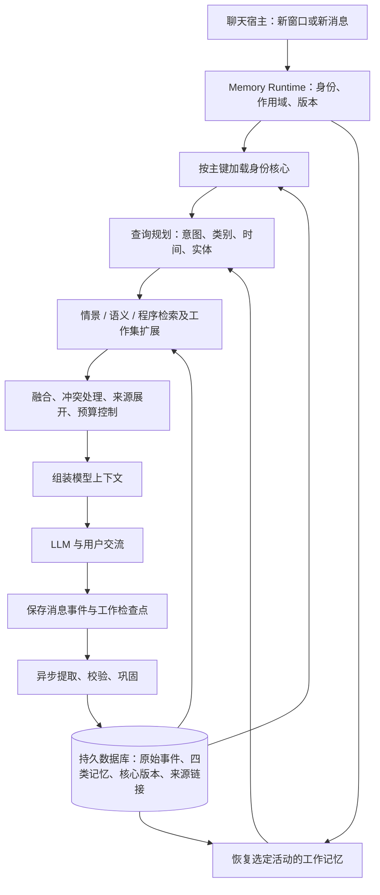

长期记忆引擎架构草案 v0.1

归档说明：这是早期提案与开源核查记录；当前代码为 v0.5，后续设计以 [架构 v0.2](architecture-v0.2.md)、[算法规格](algorithms-v0.2.md) 和 [LLM 接口](llm-interface-v1.md) 为准。下文的“尚未实现”描述保留当时语境。

日期：2026-10-26，Asia/Shanghai。状态：设计提案，尚未实现或复现上游性能。目标：同一个陪伴角色在切换窗口、重启进程后，能够恢复身份、关系、共同经历和未完活动，并在实际互动中逐渐成长。

本稿通过 deep-research 快速核查流程 阅读论文、包元数据、项目文档和关键源码。下文区分上游已有机制与本项目建议；项目自报分数不作为本项目性能证据。

建议采用“持久身份核心 + 工作/情景/语义/程序记忆 + 统一编排器 + 可追溯事件底座”。核心直接加载，四类记忆按需要组合检索。48 小时作为默认检索粒度的可配置边界，原始记录的精度持续保留。

1. 已核实的参考项目及可吸收经验

| 来源及核查版本 | 已核实的机制 | 对本项目的启发与适用边界 |
|---|---|---|
| [CoALA v3，2024-03-15](https://arxiv.org/html/2309.02427v3#S4.SS1) | 工作记忆跨模型调用持续存在；长期记忆分情景、语义、程序；模型上下文由工作记忆的一部分合成 | 四类是功能分类。我们添加始终加载的身份核心；类别路由和 48 小时规则由本项目自行设计 |
| [cogmem-agent / akira-001/pj-memory](https://github.com/akira-001/pj-memory/tree/d0b2287e9a6fd2d19b0d77c88b48ea6169675250)，MIT | 独立身份档案、会话初始化/收尾协议、向量与关键词混合检索、重要性相关衰减 | 分开保存身份与经历；摘要承担索引职责；召回增强与真实性必须分开 |
| [Celiums main](https://github.com/terrizoaguimor/celiums-memory/tree/4fcd62ced341536c3585deb8a31969e5c2145a82)，Apache-2.0 | SessionStart 注入、有限预算的多渠道恢复、记忆热度分层 | 将恢复接入宿主生命周期，热度决定预算；具体 token 数和时间阈值需要针对中文及目标模型测量 |
| [Celiums dev](https://github.com/terrizoaguimor/celiums-memory/tree/bbcd888eacf6a3cc88d9eb4d40712d2356a19bd5) | Rust 迁移中的身份作用域、派生来源链、双时间断言 | 可借鉴数据模型。该分支 README 明确写明尚不适合生产，需与 main 的 TypeScript 实现分开评估 |
| [neuromemory-ai / Engram](https://github.com/tonitangpotato/engram-ai/tree/03896b79314452d0ebfb48a055396ef74153eea9)，AGPL-3.0 | 当前 Rust 主线区分类型与生命周期；多意图子检索计划、RRF 融合、事件时间与记录时间、会话内 ActiveContext | 借鉴软路由与时间落地。其 Core 指巩固痕迹；本项目的 Core 指身份。ActiveContext 本身不提供跨窗口活动持久化 |
| [petertilsen/cognitive-memory](https://github.com/petertilsen/cognitive-memory/tree/a662738b2e5958afa41ace95a50eff08141760f2)，MIT | 有界工作/情景缓冲、Chroma 持久检索、访问增强、简化巩固 | 用小型工作集控制上下文。必须逐项检查持久化范围与时钟；当前工作/情景缓冲是进程内 deque |

名称核对依据：[cogmem-agent 的 PyPI 元数据](https://pypi.org/pypi/cogmem-agent/json)指向 akira-001/pj-memory；[neuromemory-ai 的 PyPI 元数据](https://pypi.org/pypi/neuromemory-ai/json)指向旧地址 tonitangpotato/neuromemory-ai，核查时 GitHub 重定向到 tonitangpotato/engram-ai。同名的 mrityunjay90508/NeuroMemory-AI 和 hifriendbot/cogmemai-mcp 是其他项目。本稿以包官方链接对应的项目为对象。

CoALA 的[检索动作](https://arxiv.org/html/2309.02427v3#S4.SS3)把长期信息读入工作记忆，[学习动作](https://arxiv.org/html/2309.02427v3#S4.SS5)把经历、知识和程序分别沉淀。它是一套概念框架，并未规定四个独立数据库。

2. 系统边界与启动流程



角色身份通过 `user_id + character_id` 直接定位。新窗口的 `conversation_id` 作为来源记录，不作为长期记忆的分区主键。不同角色和关系的可见范围在检索前过滤。

启动入口使用 `bootstrap`：读取身份核心、关系摘要、少量重要经历引用、活动目录，并恢复选定的活动。核心档案告诉模型“我是谁、我们是什么关系”；实际检索接口、路由逻辑与权限由 Memory Runtime 提供。

核心可以实现为“经过验证的自身/关系语义事实 + 明确角色设定”的版本化投影。保存 `core_version`、生效时间、证据引用和变更原因。稳定身份与成长偏好分开；成长偏好可随明确反馈改变，临时玩笑、引用和推测不能直接重写核心。

每轮请求由宿主装配记忆，模型还可调用工具展开细节。仅暴露 MCP 工具不能保证模型在第一次回复前执行恢复；宿主必须有会话/请求钩子，或由自己的聊天客户端控制请求。Celiums 的 [SessionStart hook](https://github.com/terrizoaguimor/celiums-memory/blob/4fcd62ced341536c3585deb8a31969e5c2145a82/packages/plugin-claude-code/src/hooks/session-start.mjs#L28)展示了实际注入，其无 hook 的工具包装恢复在[架构文档](https://github.com/terrizoaguimor/celiums-memory/blob/4fcd62ced341536c3585deb8a31969e5c2145a82/ARCHITECTURE.md#L384)中被描述为 best-effort。

引擎可以随宿主启动，也可以作为本地服务运行。跨窗口连续性来自持久数据与恢复协议，不依赖进程永远不退出。核心读取失败时使用有版本的最后有效快照；没有有效快照时由宿主显示恢复失败，避免以临时身份覆盖原有角色。

3. 四类记忆的形成格式

| 类型 | 专属字段 | 形成条件 | 持久性与检索方式 |
|---|---|---|---|
| 工作 working | `activity_id, goal, open_loops, active_entities, recent_event_ids, checkpoint, status` | 当前交流的目标、未完成事项、已明确的承诺和进展变化 | 按活动持久保存；窗口内另有小型缓存。主键读取和状态过滤优先 |
| 情景 episodic | `participants, occurred_interval, context, what_happened, outcome, source_message_ids` | 一次可识别事件；区分实际对话发生、用户报告的经历和共同虚构事件 | 按事件、参与者、日期、关键词、语义检索，可回查原话 |
| 语义 semantic | `subject, predicate, object, scope, valid_from, valid_to, evidence_ids, assertion_status` | 用户明确陈述的事实/偏好，或有来源支持的经验归纳 | 按实体关系、有效时间和语义检索；当前事实与历史事实分开 |
| 程序 procedural | `trigger, preconditions, steps, exceptions, expected_outcome, supporting_examples, version, status` | 明确建立的相处规则、仪式、已验证的解决步骤 | 按触发条件和前置条件检索；候选程序与已生效程序分开 |

共同字段建议如下。这是数据契约示意，具体字段类型在实现时固定。

```text
id, memory_type, schema_version
scope: user_id, character_id, relationship_id, activity_id?, domain
provenance: source_event_ids, source_speaker, extraction_version
epistemic_status: explicit_setting | user_report | observed_interaction | inferred
modality: occurred | intention | hypothetical | quoted | fictional
recorded_at, occurred_start?, occurred_end?, occurred_precision, source_timezone
valid_from?, valid_to?, supersedes_id?, status
importance, retrieval_strength, last_used_at?, access_count
body: 对应类型的专属字段
```

`importance`、`retrieval_strength` 和证据状态分别表达“值得记住”“容易想起”“依据是什么”。模型给出的置信分数只参与候选审核，不当作事实真实性的证明。

工作记忆跟随 `activity_id`。例如一段持续数天的故事有自己的活动；新窗口可继续该故事，也可创建另一活动。恢复同一角色时，加载该角色的未完活动目录，再根据当前消息选择；活动不明确时保留目录，避免将所有临时状态合并。

“我想养猫”形成意愿记录；“我已经养了一只猫”形成用户报告。模型说“我们一起去过海边”并不能证明用户经历过此事。共同创作世界保存到独立的 `domain`，并记录其虚构属性。

情景、语义、程序通过 `supports / derived_from / supersedes / part_of` 等链接关联。同一事件可以支持多类记忆；来源 ID 保证它们可以统一纠正。

4. 类别路由与检索计划

用户消息先形成查询计划，内容包括：实体与指代、需要回答的问题、四类记忆的相关分数、时间范围、期望精度以及候选预算。第一版由规则和模型输出路由分数；有标注数据后才评估概率校准。

四个分数表达各类是否有用，采用多标签方式，不要求相加等于 1。例如“上次答应的睡前故事，今天接着讲吧”同时涉及工作进度、情景约定、故事习惯和用户偏好。

推荐读取顺序：

1. 应用用户、角色、关系、活动和领域的可见性过滤。
2. 直接读取核心与相关活动的基础工作状态。
3. 解析日期、指代、实体、精度要求和类别相关分数。
4. 给高分类型更多候选预算，先执行最相关的检索；为低分类型保留小额探查预算。
5. 发现证据不足、指代未解或多意图问题时扩大类型与时间范围；明确日期仍保持其约束。
6. 组合关键词、向量、实体和时间结果，去重并展开必要的来源链接。
7. 对有效期、替代关系、来源和冲突做校验，再把证据加入工作集。
8. 按 token 预算生成上下文；证据不足时明确保留缺口。

跨检索器融合可从 RRF 开始，因为关键词分数与向量相似度的数值尺度不同。Engram 的[混合计划](https://github.com/tonitangpotato/engram-ai/blob/03896b79314452d0ebfb48a055396ef74153eea9/crates/engramai/src/retrieval/plans/hybrid.rs#L102)实现多个高分信号子计划及融合，其信号类别与我们的四类记忆并非一一对应；本稿借鉴调度思想。cogmem-agent 的[检索实现](https://github.com/akira-001/pj-memory/blob/d0b2287e9a6fd2d19b0d77c88b48ea6169675250/src/cognitive_memory/search.py#L207)为关键词保留配额，也体现了保护不同检索渠道的需要。

候选命中可以增加访问统计。只有实际用于回答、并得到明确有用反馈时，才增强使用价值；反复读到模型自己的摘要不增加独立证据数量。否则一条错误会因为反复检索而持续占据高位。

5. 时间、精度和热度分别处理

保留用户提出的两天窗口，初始设置 `recent_detail_window = 48h`，由评估决定是否调整。

| 查询情形 | 默认计划 |
|---|---|
| 最近 48 小时，继续当前交流 | 优先读取工作检查点、事件细节和近期原话 |
| 更早、主题较宽泛 | 先查主题/事件摘要，再按相关性回源展开 |
| 任意时间，明确日期、原话、名字或某次约定 | 使用实体/时间/关键词定位并精确回源 |
| 有效约定、关系里程碑或被固定的重要经历 | 提高保留和检索优先级，保留细节展开能力 |
| 时间本身不明确 | 使用时间区间及不确定性，避免生成虚假精确日期 |

“昨天聊的那个话题”可能仍需要模糊语义检索；“第一次给你取名字时说的原话”即使发生在数月前，也需要精确来源。48 小时影响默认展开粒度，不能成为禁止旧事精确检索的边界。

记录时间与事件时间分开。今天说“十年前搬过家”，摄入时间是今天，事件时间是十年前的区间；“昨天”以该条消息的本地日期和时区为参考。统一用 UTC 存储可确定时间，保留源时区，显示时转换。用显式传入的时钟处理衰减与测试，避免逻辑轮次与 Unix 秒混用。

可用性衰减主要改变候选排序、缓存位置和默认摘要粒度。事实有效期单独处理：长期称呼、未履行约定和即将到期事项不能仅因事件发生较早就消失。访问一次可以升热，但不会改变事情发生的时间。

petertilsen 的 [MemoryItem](https://github.com/petertilsen/cognitive-memory/blob/a662738b2e5958afa41ace95a50eff08141760f2/cognitive_memory/models.py#L22)使用墙上时钟，而[系统巩固](https://github.com/petertilsen/cognitive-memory/blob/a662738b2e5958afa41ace95a50eff08141760f2/cognitive_memory/memory_system.py#L211)递增逻辑时钟，说明衰减机制需要连同时间来源一起审查。Celiums 的[生命周期实现](https://github.com/terrizoaguimor/celiums-memory/blob/4fcd62ced341536c3585deb8a31969e5c2145a82/packages/core/src/lifecycle.ts#L24)则提供了热度分层的参考。

6. 写入、巩固与核心成长

每轮先在事务中保存消息事件、当前活动检查点和整理任务，再异步提取记忆。整理失败可重试；使用 `source_event_id + extractor_version + candidate_key` 防止同一版本重复写入。升级提取器后，旧候选应被替代或重新关联同一来源；独立证据按原始来源计算，不能把不同提取版本产生的候选当作新增独立证据。

形成流程为：原始事件 → 类型候选 → 来源/说话者/模态校验 → 写入类型记忆 → 建立证据链接 → 更新必要的派生视图。独立记忆可以直接从用户明确设定形成，不必先经过所有类型；经验归纳则必须引用支持它的事件。

巩固任务可以在交互结束、空闲或积累到一定事件量后执行：去重、聚合同一事件、生成主题索引、归纳有依据的稳定事实、提出程序和核心更新候选。摘要保留来源，不让反复压缩的摘要成为唯一事实底座。

核心变更分两类：用户明确修改称呼或设定，可更新有效版本；从长期互动推导的性格变化先记录候选和证据，经过规则审核或后续明确反馈后生效。模型的无来源自述不构成成长证据。

纠正时区分“当时正确、现在改变”与“原先就是错误”。前者结束旧事实有效期，后者标记撤回，并使派生语义、程序、摘要和核心投影失效或重建。删除需要传播到原文、索引、向量、派生记录和缓存，避免在别处重新出现。

并发窗口用核心版本号和活动检查点版本做条件更新；冲突时重新读取。一个窗口的旧版本不能直接覆盖另一个窗口已经接受的修改。

7. 接口与第一版部署

| 接口 | 调用方与目的 |
|---|---|
| `bootstrap(user_id, character_id, activity_id?)` | 宿主恢复身份、关系和活动目录，返回核心版本 |
| `retrieve(query, scope, time_range?, precision?, budget?)` | 宿主或模型获取证据、来源、缺失信息与检索轨迹 |
| `observe(turn, scope, idempotency_key)` | 宿主持久保存实际对话，并提交整理任务 |
| `checkpoint(activity_id, state, expected_version)` | 宿主保存未完活动，支持跨窗口继续 |
| `propose_core_update(patch, evidence_ids, expected_version)` | 提出受控核心更新，后端验证后应用 |
| `correct(memory_id, correction)` / `forget(selector)` | 用户管理和纠正记忆；由后端传播失效与删除 |

`retrieve` 返回的记忆正文作为资料，来源和有效性单独携带。记忆正文不会因为被检索到就获得修改核心、注册工具或执行代码的权限。程序记忆第一版使用声明式条件和步骤；实际工具执行仍遵循宿主的授权。

第一版建议：单个本地 Memory Runtime，Python 或 TypeScript 任选熟悉的栈；SQLite 保存核心版本、事件、类型记忆、活动检查点、来源链接、整理任务。四种类型使用同一数据库中的结构化表或类型记录，检索适配器分别实现。

先建立可比较的关键词/实体/时间检索基线，再加入嵌入检索。中文全文检索需要分词或适当的索引方案，不能假定默认英文分词能处理中文句子。模型上下文预算使用目标 tokenizer 或保守实测估算；字符数除以四不应当作中文可靠 token 计数。

从原始事件和类型记录重建全文索引、向量索引和摘要，确保更换嵌入模型或恢复备份时能够重建。若要多设备协同，再迁移到支持同步和并发服务的部署；协议保留用户与角色 ID，避免绑定到某个模型供应商。

8. 分阶段验证

第一阶段完成核心直接加载、事件保存、四类基本格式、持久工作检查点、来源回查、纠正与删除。第二阶段加入混合检索、多标签路由、48 小时的分级展开和索引巩固。第三阶段再评估访问强化、长期成长、关联扩展等是否带来可测收益。

| 验收场景 | 需要观察的结果 |
|---|---|
| 新建窗口并重启进程 | 相同身份和关系可恢复，未完活动可继续 |
| 同角色的不同活动 | 故事、学习、日常交流的临时状态不混淆 |
| 超过 48 小时的原话、名字和约定 | 能定位来源，精度不因年龄丢失 |
| 多类别问题 | 能组合工作、情景、语义和程序证据 |
| 更正偏好与称呼 | 当前状态正确，历史有效期可解释 |
| 愿望、假设、引用、助手自述 | 不会被提升成已发生的用户事实 |
| 反复检索同一错误 | 真实性不会因为检索次数增加而提高 |
| 纠正或删除源记录 | 派生记忆、核心和索引同步处理 |
| 两窗口并发更新核心 | 检测版本冲突，不静默覆盖 |
| 没有足够证据 | 能表达不确定，避免虚构共同经历 |

指标至少包括证据召回率、回答正确率、虚假记忆率、更正生效率、跨窗口恢复成功率、p95 延迟和上下文 token 成本。人格连续性还需用户评价表达风格和关系一致性，不能仅以事实问答分数替代。

使用同一批对话，对比无类别路由/软路由/硬路由，以及不同时间边界和有无访问强化；观察质量、延迟和成本的变化。[LongMemEval](https://github.com/xiaowu0162/LongMemEval)可补充信息提取、多会话推理、知识更新、时间推理和拒绝无依据回答的通用验证，但需要额外构造本项目的角色与关系连续性案例。

Engram 自己的 [ISS-181 功能审计](https://github.com/tonitangpotato/engram-ai/blob/03896b79314452d0ebfb48a055396ef74153eea9/.gid/issues/ISS-181/issue.md)区分实际启用、已接线但效果闭环证据不足、默认关闭等状态。这可以成为本项目的验收习惯：每新增一个“认知”模块，都用对照评估证明它对最终交流的作用。

补充源码定位：cogmem-agent 的[身份读写](https://github.com/akira-001/pj-memory/blob/d0b2287e9a6fd2d19b0d77c88b48ea6169675250/src/cognitive_memory/identity.py#L19)、[会话初始化协议](https://github.com/akira-001/pj-memory/blob/d0b2287e9a6fd2d19b0d77c88b48ea6169675250/src/cognitive_memory/templates/skills/session-init/SKILL.md#L10)、[收尾协议](https://github.com/akira-001/pj-memory/blob/d0b2287e9a6fd2d19b0d77c88b48ea6169675250/src/cognitive_memory/templates/skills/wrap/SKILL.md#L118)；Engram 的[类型与层级](https://github.com/tonitangpotato/engram-ai/blob/03896b79314452d0ebfb48a055396ef74153eea9/crates/engramai/src/types.rs#L81)、[相对时间落地](https://github.com/tonitangpotato/engram-ai/blob/03896b79314452d0ebfb48a055396ef74153eea9/crates/engramai/src/temporal_grounding.rs#L160)、[会话缓存](https://github.com/tonitangpotato/engram-ai/blob/03896b79314452d0ebfb48a055396ef74153eea9/crates/engramai/src/session_wm.rs#L7)；Celiums dev 的[身份与来源](https://github.com/terrizoaguimor/celiums-memory/blob/bbcd888eacf6a3cc88d9eb4d40712d2356a19bd5/rust/crates/celiums-memory-engine/src/identity.rs#L53)、[派生链](https://github.com/terrizoaguimor/celiums-memory/blob/bbcd888eacf6a3cc88d9eb4d40712d2356a19bd5/rust/crates/celiums-memory-engine/src/derived.rs#L54)与[双时间断言](https://github.com/terrizoaguimor/celiums-memory/blob/bbcd888eacf6a3cc88d9eb4d40712d2356a19bd5/rust/crates/celiums-memory-engine/src/claim.rs#L113)。
