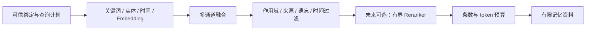

# Qwen 向量方案与本地记忆检索

更新于 2026-11-03。引擎 0.32 / 原生插件 0.19。本文记录已实现的文本嵌入适配、官方依据与后续精排/多模态设计。Qwen 是可选检索编码器；DeepSeek 继续是唯一生产 LLM 抽取目标。

## 官方方案能解决什么

[Qwen3 Embedding 官方仓库](https://github.com/QwenLM/Qwen3-Embedding)和[官方介绍](https://qwenlm.github.io/blog/qwen3-embedding/)将 Embedding 与 Reranker 分成两种模型。Embedding 把查询/正文编码到相同空间，用于召回；Reranker 对有限的查询—正文对重新判断相关性。它们改善“入睡之前听大海童话”与“喜欢睡前海边故事”这样的措辞差异，跨窗口持久化、身份恢复、授权和遗忘仍属于记忆引擎。

本轮核对了 Qwen 官方 ModelScope 组织的模型卡及配置：

| 文本嵌入模型 | 原生维度 | Matryoshka 输出范围 | 最大模型序列 | 许可证 |
|---|---:|---:|---:|---|
| [Qwen3-Embedding-0.6B](https://modelscope.cn/models/Qwen/Qwen3-Embedding-0.6B/resolve/master/README.md) | 1024 | 32–1024 | 32K | Apache 2.0 |
| [Qwen3-Embedding-4B](https://modelscope.cn/models/Qwen/Qwen3-Embedding-4B/resolve/master/README.md) | 2560 | 32–2560 | 32K | Apache 2.0 |
| [Qwen3-Embedding-8B](https://modelscope.cn/models/Qwen/Qwen3-Embedding-8B/resolve/master/README.md) | 4096 | 32–4096 | 32K | Apache 2.0 |

32K 是模型能力上界。项目默认仍只编码最多 512 token，记忆索引正文保持原有 `render(400)`；使用长上下文不意味着要把整个对话作为一条向量。

官方 [query 配置](https://modelscope.cn/models/Qwen/Qwen3-Embedding-0.6B/resolve/master/config_sentence_transformers.json)采用 `Instruct: ...\nQuery:`，文档侧不加指令；[Pooling 配置](https://modelscope.cn/models/Qwen/Qwen3-Embedding-0.6B/resolve/master/1_Pooling/config.json)为 last-token，包含 prompt。官方建议多语种任务也优先使用英文任务描述。本项目默认任务为：

```text
Instruct: Given a conversation query, retrieve relevant memories that help answer the query
Query:实际检索问题
```

任务内容由本项目定义；官方 web-search 指标不自动成为本项目的记忆质量证据。自定义指令必须保持完整格式，并重新评测、重建。

## 当前接入与部署

`Settings.embedding_profile` 提供 `generic`、`qwen3-embedding-0.6b`、`qwen3-embedding-4b`、`qwen3-embedding-8b`。Profile 统一给正常运行时、诊断 CLI、校准/验收脚本和性能基线解析数值配置。`generic` 保留原有严格等维模式与 v1 指纹。

Qwen profile 显式启用 Matryoshka：验证完整原生向量、取前 d 维、重新 L2 归一化；非法尾部也不能被截掉后忽略。加载时检查原生维度、Qwen3 backbone、仅 last-token 池化及 `include_prompt=true`，兼容新旧 Sentence Transformers 的池化字段。查询编码手动加前缀并传 `prompt=""`，避免模型自带默认指令重复叠加。模型目录若使用其他池化方式会报 `INVALID_EMBEDDING`。

Profile 是编码协议校验，不认证模型文件来源。部署者仍须准备可信本地权重、固定 revision 和校验和，不在运行中覆盖文件。本项目没有在启动时自动下载或向外部向量 API 发送记忆。

```powershell
# 在插件实际使用的 Python 环境中安装可选依赖。
python -m pip install '.[qwen]'
$env:MEMORYDREAMING_EMBEDDING_PROVIDER = 'sentence-transformers'
$env:MEMORYDREAMING_EMBEDDING_PROFILE = 'qwen3-embedding-0.6b'
$env:MEMORYDREAMING_EMBEDDING_MODEL_PATH = 'D:\Models\Qwen3-Embedding-0.6B'
$env:MEMORYDREAMING_EMBEDDING_REVISION = '填写已固定的模型提交 SHA'
$env:MEMORYDREAMING_EMBEDDING_DIM = '512'
$env:MEMORYDREAMING_EMBEDDING_QUERY_PREFIX = ''
$env:MEMORYDREAMING_EMBEDDING_DOCUMENT_PREFIX = ''
$env:MEMORYDREAMING_EMBEDDING_MAX_SEQ_LENGTH = '512'
$env:MEMORYDREAMING_EMBEDDING_BATCH_SIZE = '2'
$env:MEMORYDREAMING_EMBEDDING_TIMEOUT_SECONDS = '30'
```

可选依赖明确要求 `transformers>=4.51,<6`；仅有旧版 Sentence Transformers 不足以保证支持 Qwen3。原生插件可直接传同一配置，显式字段覆盖环境：

```yaml
embeddingProvider: sentence-transformers
embeddingProfile: qwen3-embedding-0.6b
embeddingModelPath: 'D:\Models\Qwen3-Embedding-0.6B'
embeddingRevision: '填写已固定的模型提交 SHA'
embeddingDim: 512
embeddingQueryPrefix: ''
embeddingDocumentPrefix: ''
embeddingMaxSeqLength: 512
embeddingBatchSize: 2
embeddingTimeoutSeconds: 30
bridgeTimeoutMs: 60000
# vectorMinScore: 填写本模型、维度和任务经校准后冻结的阈值
```

`embeddingDim` 是输出维度，不能用来声称减少模型本身的加载/编码成本。0.6B 的官方 safetensors 约 1.19GB，远大于现有 BGE small；512 维相对原生 1024 维只把 float32 向量正文由每条 4096 字节降到 2048 字节，不包含 SQLite 行及索引开销。CPU 实际耗时、内存、召回损失须实测。

更换权重、任务、profile、维度或最大长度会产生不同索引命名空间；不要混用旧向量。同库只有每条记忆一个投影，切换后按[原子重建步骤](semantic-embedding.md)显式 reindex。模型不可用或超时保留关键词、实体和时间通道，返回降级状态，不缓存不完整结果。核心身份恢复不依赖向量相似度；模型权重和 profile 配置不会进入 LLM 上下文。

正文批量编码按数量、输入字节和输出维度拆成有界 IPC 块；每块的模型加载/锁/编码/通信受 `embeddingTimeoutSeconds` 限制。全量重建可能包含多个块，不能把单块截止时间解释成整库重建的总耗时保证。所有块计算完成后才进行代次复核与一次原子发布，后续块失败不会删除旧投影。插件外层 `bridgeTimeoutMs` 仍可提前结束整个请求。

## 验证与验收

```powershell
# 使用当前环境/profile，只写临时评估库；0.5 仅为诊断试验值。
python -m memorydreaming eval-embedding --k 3 --min-score 0.5 --output dist/qwen-diagnostic.json

# 校准与验收分离，冻结文件绑定权重/任务/维度/数据摘要。
python scripts/quality_acceptance.py embedding --profile qwen3-embedding-0.6b --model-path 'D:\Models\Qwen3-Embedding-0.6B' --revision '填写固定SHA' --dim 512 --batch-size 2 --calibration path/to/calibration.json --evaluation path/to/evaluation.json --calibration-artifact dist/qwen/frozen.json --output dist/qwen/report.json

# 已下载权重的合成规模基线；不代表语义质量。
python scripts/benchmark_semantic.py --profile qwen3-embedding-0.6b --model-path 'D:\Models\Qwen3-Embedding-0.6B' --revision '填写固定SHA' --dim 512 --batch-size 2 --size 10000 --output dist/qwen/scale.json

# 无需下载官方权重的可选真实库执行检查。
python scripts/smoke_qwen_embedding.py --output dist/qwen-smoke/report.json
```

最后一项在临时目录生成随机的一层 Qwen3 decoder、小词表、last-token Pooling 和 Normalize，沿生产 profile/工厂、独立 worker、SQLite 重开路径执行。它验证实际模型库接口与数值/进程协议，报告固定标注 `evidence_kind=random_architecture_fixture`、`real_qwen_weights=false`、`quality_accepted=false`；不能把随机模型的执行结果用于选择检索阈值。临时模型不会写入用户数据库。

此前真实 BGE 的诊断与一万条性能证据见[质量验收](quality-acceptance.md)，不能转用于 Qwen。本轮没有下载或运行官方 Qwen 权重，没有独立中文质量结论。

本轮验证结果：829 项 unittest、安装版 Harness 的 27 条隔离路径、默认原生前端构建一致性检查通过。真实 BGE 在新分块编码路径重跑原 16 题合成诊断，12 个正例 Recall@3/MRR/Top1 均为 1，4 个负例误匹配为 0，仍不是独立人工质量验收。随机 Qwen3 架构检查通过正式 profile、1024→32、进程持有/关闭和 SQLite 作用域隔离；直接与子进程输出最大差为 0。诊断报告位于忽略的 `dist/qwen-smoke/`，不包含用户记忆或官方 Qwen 权重。

## 待办：有限候选精排

已核对 [Qwen3-Reranker 官方模型卡](https://modelscope.cn/models/Qwen/Qwen3-Reranker-0.6B/resolve/master/README.md)。它比较查询—文档相关性；官方实现读取末 token 的 yes/no logits，经二类 softmax 或对 logit 差做 sigmoid 得到分数。相关性分数不能解释成事实真实性。



后续工作包的完成条件：

- 先过滤不可见候选，再对有限条目精排；限制条数、每条长度和总截止时间，不把全部记忆发送给精排模型。
- 建立独立排序键或明确分数融合策略；不能只重排列表后又被现有 `_apply_budget` 的融合分排序覆盖。
- 模型版本、任务、截断、候选窗口和分数策略进入缓存指纹；失败保留原排序并标降级，降级结果不缓存。
- 首版对 `knowledge_at` 历史查询跳过精排；以后支持时只能使用对应历史修订正文。
- 以相同人工标注和冻结政策对比 BGE、Qwen Embedding、加 Reranker 三种配置的召回、无依据误匹配、延迟和内存，再决定是否推荐。

这些条件尚未实现；本轮不增加默认精排模型或后台常驻大模型。

## 待办：图片和共同经历的多模态记忆

另有 [Qwen3-VL Embedding/Reranker 官方方案](https://github.com/QwenLM/Qwen3-VL-Embedding)和[官方 2B 模型卡](https://modelscope.cn/models/Qwen/Qwen3-VL-Embedding-2B/resolve/master/README.md)，支持文本、图片、截图、视频及混合输入。它对“共同看过的照片”有价值，但需要独立的附件来源、访问授权、保留/删除传播及可复查描述，再建立单独向量空间，不能与当前文本索引混用。该方向已加入后续待办，当前没有附件导入或多模态检索实现。
