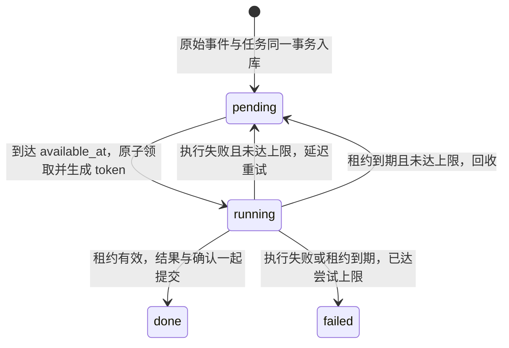

# 可靠巩固任务（v0.5）

用户消息先通过 `observe()` 保存为原始事件并排入 extract 任务。即使此后进程退出，下一次运行巩固仍能继续处理。这里保证的是本地 SQLite 事务内的副作用一致性；外部抽取器可能执行多次，因此必须保留稳定的候选幂等键。

## 状态与所有权



每次领取使用新的随机 `claim_token`，并增加 `attempts`。只有状态仍为 running、token 匹配、且 `lease_until > now` 的持有者才能完成、失败、主动释放或续租。失去资格时抛出 `JobLeaseLost`，旧执行者的结果被丢弃。

`max_attempts` 在入队时保存，包含第一次尝试和崩溃前已经领取的尝试。默认上限 3 次；修改全局配置只影响新任务。失败重试按基础间隔乘以 `2 ** (attempts - 1)` 计算，并限制最大间隔。租约到期回收的任务立即可重新领取，达到上限则进入 failed，保留失败信息。

## 每批如何执行

1. 在短事务中回收过期任务，冻结本批可执行的就绪任务 ID。没有抽取器时保留 extract，尚无执行器的 propose_core 也不消耗尝试次数。
2. 真正执行每条任务前才原子领取，避免后排任务在等待期间过期。其他 worker 已经取走的候选直接跳过。
3. 抽取器在写事务外计算候选，文件库由后台心跳线程定期续租。线程持有独立 SQLite 连接，不跨线程复用主连接。
4. 开启 `BEGIN IMMEDIATE` 并检查所有权，写入记忆、事实失效与来源链接、向量和后续任务。
5. 写入末尾再次以凭证和当前时间完成任务，然后一起提交。任何一步失败或过期，全部回滚。报告中的 created/merged/summarized 只统计已提交的结果。
6. 普通执行失败由仍有所有权的 worker 记录并设置下次可用时间。失去租约时不修改新持有者的状态，由新持有者或下一批回收处理。

本批运行中新增的 dedupe/summarize 留到后续调用。`limit` 限制本批候选数量，并发竞争时实际领取数可能小于它。崩溃回收没有常驻计时器，由下一次 `run_consolidation()` 触发。

## 配置与观察

| Settings 字段 | 环境变量后缀（前缀为 MEMORYDREAMING_） | 默认值 |
|---|---|---|
| job_lease_seconds | JOB_LEASE_SECONDS | 120 秒 |
| job_max_attempts | JOB_MAX_ATTEMPTS | 3 |
| job_retry_base_seconds | JOB_RETRY_BASE_SECONDS | 5 秒 |
| job_retry_max_seconds | JOB_RETRY_MAX_SECONDS | 300 秒 |

这些配置必须是正整数，重试间隔上限不能小于基础间隔。心跳间隔为租约的三分之一，最长 30 秒。长任务需要让心跳线程有运行机会，并使用一致的 UTC 时钟。

```bash
python -m memorydreaming --db my.db consolidate --limit 20
python -m memorydreaming --db my.db jobs
```

`jobs` 和 `runtime.job_stats()` 返回同一快照：pending、ready、scheduled、running、expired、done、failed。ready/scheduled 属于 pending；expired 属于 running，不可把所有计数相加。这里的 ready 表示时间和尝试次数允许领取，具体 worker 还会筛选支持的任务类型。failed 任务需要检查 `last_error` 后由维护者处理，当前没有自动重置最终失败任务的 API。

`consolidate` 报告增加 recovered（回收数，包含因上限转为 failed 的任务）和 lease_lost（失去提交权）。failed 是本批记录的执行失败数，包含已安排重试的尝试；最终失败总量请看 `jobs.failed`。本批出现 failed/lease_lost 时 CLI 返回 1，便于脚本识别异常。没有就绪任务返回成功，不会忙等到退避结束。

v0.6 增加 suppressed（被遗忘账本隔离的候选）和 stale_results（计算期间内容代次变化，结果丢弃重排）。worker 在计算前记录精确 scope epoch，写入与完成前复核；仍有租约时释放过时任务，不消耗这次尝试。stale_results 本身不算执行失败；下一批对存续原文重新抽取，并再次检查每条候选。机制见 [事实抑制](fact-suppression.md)。

## 迁移和边界

数据库结构 v5 从 v4 原子增加字段与索引，保留任务 ID、payload、状态和尝试次数。旧任务默认最多尝试 3 次；没有 token/lease 的旧 running 行按失联任务回收。重复打开不会再次改写租约或重置尝试次数，较新结构仍被拒绝。

- 各 worker 使用独立 runtime/连接；SQLite 仍只有一个写入者，适合本地单机。这里没有提供跨设备队列或常驻调度服务。
- `:memory:` 没有可供心跳线程共享的文件，只提供同步的租约校验。超过租约的执行会回滚。
- 向量计算及去重/摘要计算仍在结果事务内。长写事务会阻止心跳写入；租约耗尽时系统选择回滚，避免越权提交。默认哈希嵌入很快，接远程嵌入或大批巩固前需要把计算阶段进一步移出写事务，或合理调整租约。
- 外部模型调用可重复，并不会被取消或回滚；不要让抽取器发送消息或做不可逆操作。只把候选记忆作为结果返回，再由引擎提交。
- 这一步没有实现完整遗忘、宿主新窗口钩子或真正的语义嵌入。

## 验证与参考

`tests/test_job_leases.py` 覆盖竞争领取、过期接管、旧 token 拒绝、退避与尝试上限、配置、迁移、心跳和事务回滚。崩溃测试在子进程已经写入但尚未提交时强制终止它，再以新的运行时恢复，验证没有部分记忆、没有重复记录，后续任务仍能入队。抽取、去重、摘要都验证了完成确认失败后的回滚行为。

机制参考：[Procrastinate 失联任务检测](https://github.com/procrastinate-org/procrastinate/blob/main/procrastinate/sql/queries.sql#L39)、[Celery visibility timeout](https://github.com/celery/celery/blob/main/docs/getting-started/backends-and-brokers/sqs.rst#L87)、[Celery 任务确认与幂等](https://github.com/celery/celery/blob/main/docs/userguide/tasks.rst#L21)。本实现保留标准库和 SQLite，无新增运行时依赖。
