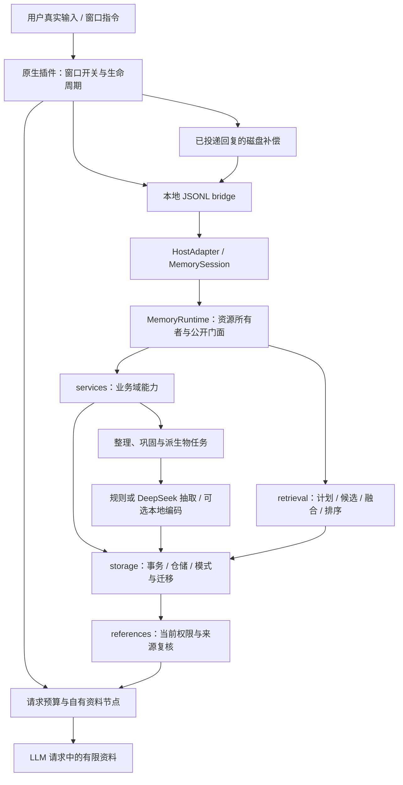

# MemoryDreaming 系统架构与扩展指南

本文按当前代码的真实职责组织，作为后续开发入口。宿主使用原生 Cordis 插件和本地 JSONL bridge；LLM 只接收预算内的资料，不需要了解数据库、任务队列或迁移结构。

## 运行链路

窗口指令由可信宿主识别，不能从模型输出、引用原文或工具结果中取得控制权限。按窗口启用是原生插件的职责；同一角色的长期记忆仍按用户、角色、关系、活动和领域隔离，conversation_id 只用于来源与会话控制，不把长期记忆重新绑定在单个窗口里。

## 代码导航

| 模块 | 负责的内容 | 不承担的职责 |
|---|---|---|
| `integrations/deepseek-harness/lib/index.js` 与相邻模块 | Cordis hook、窗口控制、请求预算、单资料节点、进程管理、磁盘投递补偿 | 从模型文本推断审批权、直接操作 SQLite |
| `bridge.py` | 固定可信身份绑定、多 conversation 路由、JSONL 请求边界、固定错误码 | MCP 工具目录、网络监听、自动改变模型账号 |
| `host.py` | 会话绑定、prepare/delivery、引用、查询预算、提议与可信审批入口 | 直接复用别的窗口引用、把记忆提升为系统权限 |
| `runtime.py` | 创建并关闭连接、时钟、编码器、后台 worker；启动恢复、检索、真实事件观察 | 集中堆放全部业务实现、隐式创建第二套服务连接 |
| `sleep.py` / `storage/sleep-schema.sql` | 冻结本窗来源、分片租约、候选审阅、生成虚构梦、可逆权重与苏醒 | 将梦/候选笔记自动写成事实，修改人格/原话或物理遗忘 |
| `life_evidence.py` | 角色投影共用的来源固定版本、规范排序、存活外部根与用户依据校验 | 接受梦/叙事作为事实根、认证自然语言授权意图 |
| `narrative.py` / `companionship.py` / `growth.py` | 自传、场景偏好、表达成长的候选、审批、版本、撤销和历史保护 | 模型自己审批、自动修改核心、撤回后回退旧值 |
| `intentions.py` | 未完承诺、时间/事件条件、主动策略、安静时段、配额、租约与回执 | 自行发送消息、将提醒投递当成完成承诺 |
| `continuity.py` / `portability.py` | 有界苏醒状态卡、私密档案、空白新设备恢复、遗忘屏障与指纹核验 | 向模型提供恢复密钥、抹掉非空目标的删除历史 |
| `life.py` / `life_commands.py` | 少量已确认角色资料与真实用户完整JSON命令的快捷审批 | 把模型复述/拼接参数当作用户授权 |
| `services/activities.py` | 活动、检查点、跨窗口 handoff，版本条件更新 | 把工作摘要写成身份核心或真实事实 |
| `services/core.py` | 核心字段补丁、双时间回放、类型化支持组入口 | 自动批准人格变化 |
| `services/mutations.py` | 纠错、事实/事件/范围遗忘、受控重新学习、变更传播 | 猜测用户是否同意、假称外部备份已经擦除 |
| `services/consolidation.py` | 整理任务入口、向量重建、摘要撤回/历史恢复/展开 | 将摘要或生成物作为新的独立证据 |
| `services/maintenance.py` | 健康、持久指标、实体查询/重建、审计链、快照入口 | 把访问次数和模型自评视为真实性 |
| `storage/database.py` / `storage/repository.py` | 连接、显式事务、原子迁移、领域对象存取、代次触发器 | 跨用户授权、调用慢模型 |
| `retrieval/` | 类别/时间计划、关键词/向量/图候选、融合、衰减、预算 | 绕过遗忘账本、给召回结果修改权限 |
| `references.py` / `evidence.py` | 会话随机引用、逐跳可见性、AND/OR 支持组及外部根验证 | 用循环依赖证明事实、无限深度展开 |
| `consolidation.py` / `worker.py` | 租约、心跳、退避、事务外抽取/编码和原子确认 | 重放过期 worker 的结果 |
| `formation.py` / `extractors.py` / `llm_extractor.py` | 四类正文契约、来源片段、规则或 DeepSeek 候选 | 接受模型直接修改核心或数据库 |
| `temporal.py` / `proposals.py` / `batches.py` | 历史投影、候选审批、整批原子执行 | 把 proposed 当作 applied |
| `quality_acceptance.py` / 评估脚本 | 冻结阈值、分离校准/验收、真实模型证据和人工复核门槛 | 自己签署“独立人工验收通过” |

原 `runtime.py` 的活动、核心、变更、整理和维护实现拆入 `services/`，门面由这些能力类组合而成。能力类没有构造器，也不拥有独立状态；所有方法在同一个 `MemoryRuntime` 实例上执行，继续调用 `self.method()`。因此原有公开签名、宿主覆写、故障注入和嵌套事务语义保持兼容。内部 `_PreparedCorrection` 与纠错计划指纹兼容入口仍可从原门面模块引用。

原生端也按变化原因拆分：`index.js` 只编排生命周期；`native-session.js` 适配宿主消息与可替换节点，`window-control.js` 解析完整指令并持久化每窗开关，`sleep-coordinator.js` 在有界独立请求中审阅分片，`durable-files.js` 统一窗口状态/outbox的fsync原子发布。`SleepService` 由唯一 Runtime 构造并通过 `runtime.sleep` 暴露，不创建第二个数据库或后台模型线程。详见 [实际指令与算法](window-sleep-wake.md)。

这种拆分是保持既有 API 的渐进迁移，不要求调用方实例化五个服务。新增业务先放在对应能力模块；跨业务的长流程增加独立编排服务。避免业务能力相互导入或在模块加载时读取用户数据库。

v0.29的长期角色服务由唯一Runtime构造，通过`narrative/intentions/companionship/growth/continuity`暴露，仍共享同一连接与事务。新增18张表分在四份领域schema中，统一进入schema27迁移、完整/范围快照和范围物理清除。普通回合通过`life.role_context`只读快照选取少量已确认资料；苏醒附加`continuity.check`。资料过大优先移除角色块，继续由总记忆/完整请求预算裁剪。

原生`life-commands.js`只解析完整真实用户消息；桥接端再次核对已保存原话、message_id、完整绑定和参数。通用SDK的提议与审批仍分离；原生完整JSON命令表示用户直接给出内容，允许在同一事务提议并确认。普通自然语言推断没有这条快捷授权。主动队列通过内部JSONL的claim/validate/ack接宿主，不注册模型工具，也没有自行启动外部发送通道。详细入口见[长期角色](long-term-role.md)。

## 数据层次与来源

1. **事件层**保存实际发生的用户/角色消息及时间，是事实抽取的来源底座。控制指令可以独立审计，不因模型复述指令而生效。
2. **记忆层**保留工作、情景、语义、程序四类格式。epistemic_status、modality、source_event_ids 和精确 source_spans 决定它表示用户自述、明确设定、观察、推断、愿望还是虚构。
3. **核心层**是受控身份与关系投影，包含字段级来源和版本；不因高召回分或热度自动变化。
4. **派生层**包含摘要、向量、实体索引、缓存及生成物。每项派生物必须可追到存活来源；模型生成的正文不创造新的独立事实根。
5. **控制/审计层**保存租约、回执、遗忘屏障、窗口状态和生命周期。它影响有效性，但不作为日常模型上下文整段发送。

自传、承诺、偏好与成长属于带状态的角色投影，不增加第五类事实记忆。每项保存精确作用域、版本及实际来源，读取时重新复核；派生叙事不能相互背书形成新证据根。投影失效同时影响当前值、历史正文、候选和恢复卡，不能靠旧回执绕过遗忘。稳定内容签名用于去重/拒绝保护，与事实真实性分开。

睡眠整理属于新的编排能力，不把四类记忆改成五类。梦境应作为明确标记的生成派生物单独存储，保留采样来源和生成方式；梦中组合出来的情节不进入用户事实、核心字段或独立支持计数。苏醒展示的是梦的回顾，不是“我们实际一起经历过”。具体睡眠状态、指令和接口由同轮新增的睡眠实现说明维护。

## 不可放松的执行约束

**可信绑定先于查询。** 宿主构造 SessionBinding，模型不能传入新的 user_id 或自行签发 mref。活动可见目录、关系和领域检查发生在候选 LIMIT 前以及最终读取时；召回分数不替代授权。

**一个运行时拥有一套资源。** SQLite 连接绑定线程，后台整理/预取自己建立连接。能力类共享门面的连接。可选本地编码进程由运行时拥有并在关闭时回收；自行注入的编码器遵守调用方明确的生命周期契约。

**慢计算离开写事务。** 抽取、网络调用、向量计算先形成快照计划，再退出事务计算，发布时复核内容代次、遗忘 epoch、引用版本和任务租约。主记录、索引、派生失效、回执和任务完成在同一个最终事务内生效；任何失败全部回滚。

**取消不是回滚已提交事务。** bridge 或宿主在回执前退出可能已有提交。用户事件使用相同 message_id，投递使用相同用户事件/回复 ID/正文/状态重试。磁盘 outbox 在发布回执前持久化，并凭遗忘 guard 拒绝旧排队内容复活。

**读取仍要重新校验。** 缓存只存候选 ID、摘要与版本；命中后为当前会话新签发引用。摘要、梦、核心历史、图邻居和向量都不能绕过当前遗忘账本。AND 组全部成立，OR 组任一完整成立；无外部根的循环不存活。

**模型预算覆盖完整请求。** 插件只替换自己拥有的资料节点。预览用于分配记忆预算，发送前再次核验完整冻结请求；计数器是否 exact 必须与模型、tokenizer、投影和模板证据一致。文件/图像等不支持项明确降级，不用 JSON 长度冒充视觉 token。

## 扩展位置

| 想扩展的能力 | 推荐入口 | 必须维持的契约 |
|---|---|---|
| 新宿主或新的窗口指令 | 原生 adapter / `bridge.py` / `host.py` | 可信用户源、固定绑定、只影响已启用窗口、取消与幂等 |
| 新抽取方法 | `MemoryExtractor` / formation policy | 返回候选；来源片段、认识论状态、模态、四类最小格式 |
| 新嵌入模型 | `Embedder` 与版本化配置 | 文档/查询前缀、维度、归一化、不可变 revision、超时与原子重建 |
| 新检索通道 | `retrieval/pipeline.py` 中的候选接入 | 范围先过滤、候选有界、融合后最终读取复核 |
| 新记忆编排流程 | `services/` 或独立编排模块 | 资源不重复创建、慢计算不占写锁、状态/回执原子落库 |
| 新审批动作 | `proposals.py` / `batches.py` | 模型只提议；可信宿主决定；期望版本、来源与遗忘复核 |
| 新表或派生物 | schema + migration + portability + scope purge | 原子升级、重复打开、快照预检、逻辑/物理遗忘传播 |
| 梦境、反思或生成故事 | 独立生成派生物服务 | 明确虚构、来源可撤销、不强化真实性或覆盖核心 |

新功能发布前应更新能力声明与专项文档；只有真实实现并通过必要验收后才能在接口宣称支持。正式质量验收与模拟/合成回归继续分开记录。

## 推荐阅读与验证顺序

先读 `models.py` 与 `host.py` 的绑定/回合契约，再读 `runtime.py` 的资源初始化和读写入口。活动、核心、纠错或整理问题直接进入相应 `services/` 文件；数据库结构从 schema 与 migration 看起。遇到权限/遗忘问题先检查 `references.py`、`evidence.py` 和 forgetting 仓储，不先调召回阈值。

拆分本身不引入新的行为或新的授权入口。验证依靠既有纠错、遗忘、历史、快照、任务、宿主与原生插件回归；不为“文件从 A 移到 B”新增镜像实现的测试。睡眠与窗口控制的行为变化需要各自覆盖正常路径、恢复、并发、来源撤销和预算边界。
